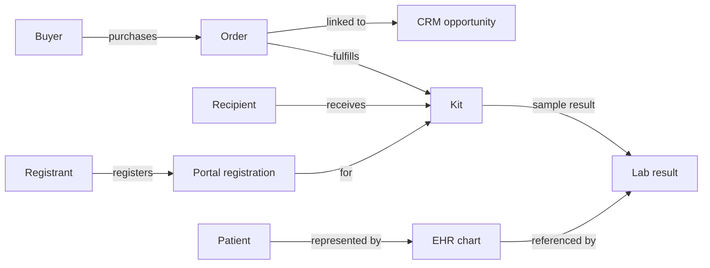
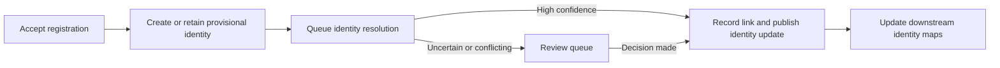
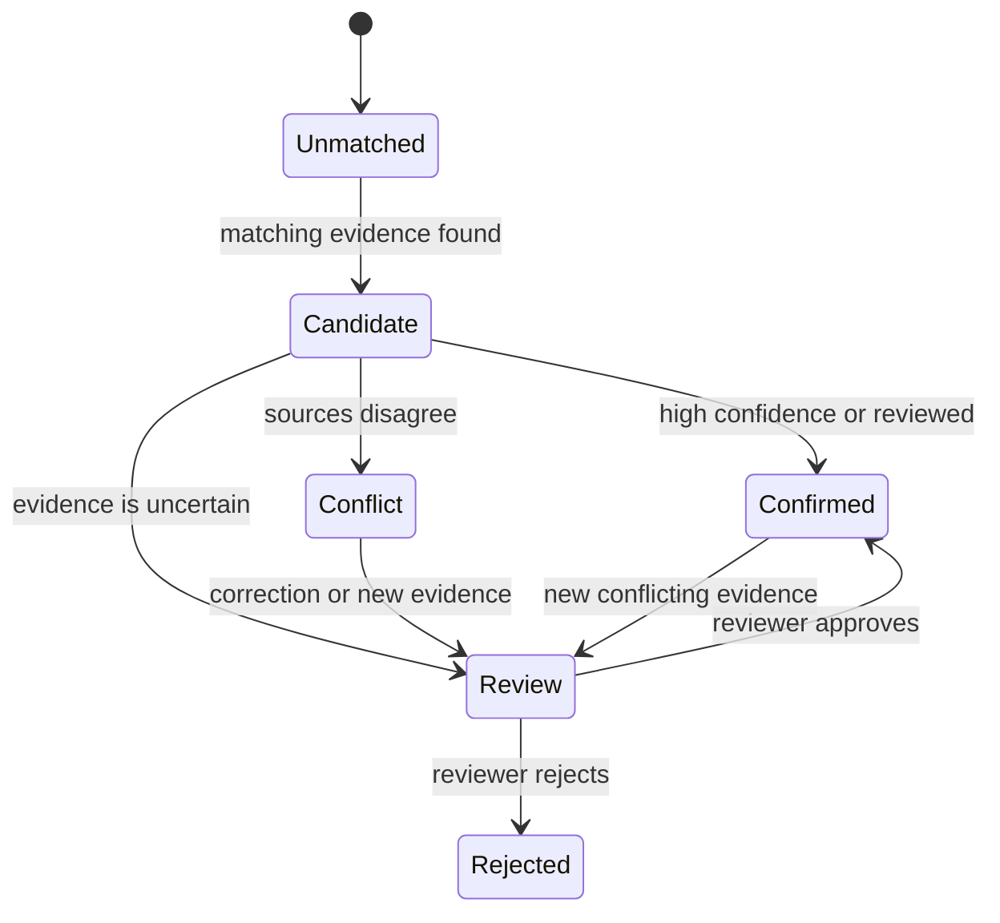

# Codex work session — 2026-11-09

Source session IDs: 01a1c18c-9821-7940-bfb5-6b1f624b0b1a, 01a1c18c-9821-7940-bfb5-6b1f624b0b1a.
Source files: rollout-2026-11-09T13-22-59-01a1c18c-9821-7940-bfb5-6b1f624b0b1a.jsonl, rollout-2026-11-09T13-47-14-01a1c1a2-cc59-7442-b379-a04bff1a089e.jsonl.

This is a readable export of visible user prompts and assistant replies. System and developer instructions, hidden reasoning, and internal tool payloads are excluded. Exact customer-data values, contact details, and personal names were redacted where detected. Brand references were normalized to Lumen Health.

## User
 
# AGENTS.md instructions

<INSTRUCTIONS>
# Start here

The record of who [OWNER] is, how work flows, the project hierarchy, the rules and the decisions is `~/Projects/hq/AGENTS.md`.
Read it at the start of a session, then `~/Projects/hq/STATUS.md` for where every stream stands.
Each project under `~/Projects/hq/projects/` has its own `AGENTS.md` or `CLAUDE.md`; read that next.
</INSTRUCTIONS><environment_context>
  <cwd>[PROJECT ROOT]</cwd>
  <shell>zsh</shell>
  <current_date>2026-11-09</current_date>
  <timezone>America/New_York</timezone>
  <filesystem><workspace_roots><root>[PROJECT ROOT]</root></workspace_roots><permission_profile type="disabled"><file_system type="unrestricted" /></permission_profile></filesystem>
</environment_context>

## User
 
I received this email from a recruiter and put the files in this directory. Please don't make any changes yet. Let me know what we need to do here?

 
[RECRUITER] <[REDACTED CONTACT]>
Attachments
12:47 PM (35 minutes ago)
to me

Hi [OWNER],

[Recruiter email body removed]

[RECRUITER]

Talent at Lumen Health

## Assistant
 
I’ll review the project guidance and the recruiter’s attached files, then summarize the assignment, deliverables, and any decisions or questions to resolve. I won’t modify anything.

## Assistant
 
The HQ guidance says this directory is a job-search case study, so I’m checking its local instructions and inventorying the attachments now. I’ll treat the brief and archive as read-only.

## Assistant
 
The assignment brief is a PDF, so I’m applying the PDF review workflow to read its text and check its pages. I’ll also inspect the archive contents without extracting or changing them.

## Assistant
 
I’ve got the full brief. It calls for a diagnostic write-up, an identity-resolution prototype that emits two CSVs, a precise build spec, a rollout plan, an executive summary, and an AI-use log. I’m checking a few source locations and the repository state so I can point to the concrete failure modes and distinguish confirmed bugs from gaps the prompt leaves open.

## Assistant
 
## What they’re asking for

The brief estimates **6 to 8 hours**. It asks you to:

- Explain how the current sync works and diagnose the six reported customer-data problems, citing code locations.
- Design a single customer identity across e-commerce, CRM, the member portal, and the EHR, including how you handle uncertain matches and protect health information.
- Build a runnable prototype that reads the supplied data and writes `identities.csv` (one row per source record, with a person key and confidence) and `review_queue.csv` (uncertain links with reasons).
- Write a precise build spec for one part of the design, a 90-day rollout plan, and a one-page executive summary.
- Add `AI_LOG.md` describing the tools you used, examples where AI helped and where it was wrong, and transcripts if available.

They want a repository or zip with the code, both CSVs, the AI log, and your written answers. The review is 90 minutes: about 30 minutes presenting, 20 minutes navigating code live, 20 minutes discussing a changed requirement, and 20 minutes for questions. The brief says the company and records are fictional, but asks you to design as if the data were protected health information. :codex-file-citation{path="[PROJECT ROOT]/BRIEF.pdf" purpose="source"}

## What stands out in the code

There are several concrete issues to investigate and explain:

- **Orders can attach to the wrong household member:** when ID and email lookups fail, the sync can match on last name and ZIP, then take the first result. :codex-file-citation{path="[PROJECT ROOT]/legacy-sync/legacy_sync/sync/order_sync.py" purpose="source"} :codex-file-citation{path="[PROJECT ROOT]/legacy-sync/legacy_sync/crm/client.py" purpose="source"}
- **CRM email can be overwritten:** each order updates the matched account’s primary email from the order email. :codex-file-citation{path="[PROJECT ROOT]/legacy-sync/legacy_sync/crm/client.py" purpose="source"} :codex-file-citation{path="[PROJECT ROOT]/legacy-sync/legacy_sync/sync/order_sync.py" purpose="source"}
- **Registrations can be blocked as duplicates:** account creation is blocked when first name, last name, and ZIP match another account. The registration code turns that block into a failed registration. :codex-file-citation{path="[PROJECT ROOT]/legacy-sync/legacy_sync/crm/duplicate_rules.py" purpose="source"} :codex-file-citation{path="[PROJECT ROOT]/legacy-sync/legacy_sync/registration/register.py" purpose="source"}
- **Some gift moves can fail:** the registration flow moves the opportunity to the registrant, but the CRM stand-in rejects moves to accounts owned by inactive users. :codex-file-citation{path="[PROJECT ROOT]/legacy-sync/legacy_sync/registration/register.py" purpose="source"} :codex-file-citation{path="[PROJECT ROOT]/legacy-sync/legacy_sync/crm/client.py" purpose="source"}
- **Opt-out can be lost during account merges:** the merge omits consent fields, while new accounts default to opted in. :codex-file-citation{path="[PROJECT ROOT]/legacy-sync/legacy_sync/consent/merge.py" purpose="source"} :codex-file-citation{path="[PROJECT ROOT]/legacy-sync/legacy_sync/crm/client.py" purpose="source"}

For the marketing symptom, be careful about the claim: the stage helper returns `results_ready` first when it receives results keyed by account, but this repo doesn’t show how results get mapped to accounts. That leaves an identity-linking gap to investigate, rather than a confirmed bug in the helper itself. :codex-file-citation{path="[PROJECT ROOT]/legacy-sync/legacy_sync/marketing/stage.py" purpose="source"}

## Suggested next steps

1. Reply to [RECRUITER] with a few windows for the 90-minute review and ask when they’d like the submission.
2. Work through the six symptoms, clearly marking what the code proves and what needs validation against the data.
3. Build the identity resolver with a review queue for uncertain matches. The key design constraint is that registration must continue even when identity is unresolved; reconciliation can happen afterward.
4. Package the prototype, written deliverables, and AI log, then prepare a short presentation and a few code-navigation examples.

I haven’t changed any files. The project repository is clean, and I didn’t run its tests.

## User
 
In general how would you solve a problem like this? I have my opinions. What do you think we need to do here?

## Assistant
 
I’ll give you my architecture view first, grounded in the case’s constraints. I’m also checking the brainstorming guidance because you’re inviting a design discussion; I’ll keep this at the proposal level and won’t touch the files.

## Assistant
 
My main design instinct is to treat this as **identity plus relationships plus workflow**, with a high cost for incorrectly joining two people. The brief’s word “customer” hides several roles: the person who buys a kit, the person who receives it, the person who registers it and the patient whose results go into the EHR. A gift can involve several of those people. The model should keep those roles separate. :codex-file-citation{path="[PROJECT ROOT]/BRIEF.pdf" purpose="source"}

I’d model a stable internal person ID and a traceable link from each source record to that ID. Keep the evidence and history for every link: which source records were joined, why, how confident the match was and whether it was reviewed. Keep kits and purchases as their own records with explicit buyer, recipient and patient relationships. That gives you a way to correct or undo a bad link without losing the original records.

For matching, I’d use a cautious hybrid:

- Trust explicit, well-understood links between systems as strong evidence, such as an order linked to its kit and a lab result linked to that kit.
- Use email, phone, name and date of birth as supporting evidence, with conflicts and shared contact details lowering confidence.
- Don’t let a shared address or household contact merge people. Send ambiguous cases to a review queue with a plain reason.
- Favor a missed automatic match over a false merge. A false merge can expose one person’s results to another; a review queue costs staff time.

The prototype can demonstrate that approach with the required identity file and review queue. I’d keep it small and explainable for this exercise, then describe a production identity service as a later step.

The operating rule I’d protect from day one is that **kit registration succeeds even when identity is uncertain**. Accept the registration, attach it to a provisional record and resolve the identity asynchronously. Then hold any identity-dependent action, such as attaching results to a patient or deciding a marketing stage, until the link is reliable. That meets the brief’s constraint without pretending uncertainty has gone away.

Consent should have its own history and rules. Merging identity records must not erase an opt-out; an effective opt-out should persist until there is explicit evidence of a later opt-in. Marketing stage should be derived from linked events, with results taking precedence over registration, and should fail safely when the relevant identity links are unresolved.

For rollout, I’d start with a shadow run: generate proposed links and compare them with human-reviewed cases while the existing flows continue. Track false matches, missed matches, review volume and registration latency. Then pilot the new links with a small set of consumers, with rollback available. Separately, I’d address the confirmed unsafe behaviors in the sample code: the last-name-plus-ZIP account fallback, overwriting the primary email from an order and dropping consent fields in an account merge. :codex-file-citation{path="[PROJECT ROOT]/legacy-sync/legacy_sync/sync/order_sync.py" purpose="source"} :codex-file-citation{path="[PROJECT ROOT]/legacy-sync/legacy_sync/consent/merge.py" purpose="source"}

Because the exercise says to treat the data as PHI, I’d also explain how access is limited, how reads and changes are audited and how much identifying data each service actually needs. HHS frames protection around risk analysis and limiting PHI to what is reasonably necessary for the purpose. [HHS risk analysis guidance](https://www.hhs.gov/hipaa/for-professionals/security/guidance/guidance-risk-analysis/index.html), [HHS minimum necessary guidance](https://www.hhs.gov/hipaa/for-professionals/privacy/guidance/minimum-necessary-requirement/index.html)

That approach gives the presentation a clear through-line: **separate people from their records and relationships, make links explainable and reversible, and keep customer workflows moving while uncertainty is reviewed**. It also gives you a strong answer if the team changes an assumption live: you can show which relationship or matching rule changes, without collapsing the whole design.

What’s your main instinct so far: is the hard part the matching strategy, or getting the business to agree on what “one customer” means?

## User
 
Are there any issues with time here if we do this async?

## Assistant
 
Yes, but the brief estimates **6 to 8 hours of work**, not a deadline. Doing it across several sessions should be fine. The main risk is losing time reconstructing decisions and AI usage later, so keep a running log of prompts, tools, useful results and mistakes as you go. :codex-file-citation{path="[PROJECT ROOT]/BRIEF.pdf" purpose="source"}

I’d ask [RECRUITER] for the submission deadline when you reply with availability for the 90-minute review. Then we can schedule the work backward from that date.

## User
 
No but the deduping of the customer data?

## Assistant
 
Ah, you mean **asynchronous customer deduplication**. Yes, it creates a period where duplicate records may exist. That’s manageable, and the brief’s requirement that registration never wait for identity means we need to design for that period explicitly. The current registration flow resolves identity before accepting the kit, which is exactly the coupling the requirement rules out. :codex-file-citation{path="[PROJECT ROOT]/BRIEF.pdf" purpose="source"} :codex-file-citation{path="[PROJECT ROOT]/legacy-sync/legacy_sync/registration/register.py" purpose="source"}

I’d accept the registration immediately, give it a provisional identity if needed, then resolve and consolidate records asynchronously. During the gap:

- Make processing safe to retry, so duplicate events or concurrent orders don’t create uncontrolled duplicates.
- Keep source records and identity decisions traceable and reversible, so a mistaken merge can be corrected.
- Keep results unattached to a patient, and hold identity-dependent marketing, until the link is trustworthy.
- Define how quickly the matching queue should clear, and alert if it falls behind.
- Handle late or out-of-order events so an older update can’t overwrite a newer identity decision or consent choice.

So the tradeoff is **temporary duplicates and delayed downstream updates** versus **blocking registration or making a risky automatic merge**. I’d accept the temporary inconsistency, but make “pending identity” visible to downstream systems and suppress actions that could expose results or send the wrong message.

## User
 
ok lets break down the asks into a plan of work.

## Assistant
 
I’ll turn the brief into a staged, time-boxed work plan, keeping the async identity-resolution constraint explicit. I’ll keep it in chat for now and won’t edit the project.

## Assistant
 
I’m using the writing-plans skill to structure this into concrete phases and checkpoints. Since you asked for no changes yet, I’ll leave the plan here instead of saving it into the project.

## User
 
- Explain how the current sync works and diagnose the six reported customer-data problems, citing code locations.

I need this in an html file with diagrams, flows and schemas if need be

## Assistant
 
Understood. **The current-system diagnosis will be a standalone HTML deliverable** with embedded diagrams and source references, not just prose in the final submission. Since you asked me not to change files yet, I’m adding it to the plan without creating it now.

## Work plan

| Step | Work and output | Time |
|---|---|---:|
| 1. Trace current behavior | Follow the order, registration, merge and marketing flows through the Python code. Separate confirmed causes from symptoms the code cannot prove. | 1 hr |
| 2. Build the HTML diagnosis | Create a self-contained, navigable report with an overview, order and registration flow diagrams, source-system ID/link schema and a six-symptom findings table with file and line references. Mark the marketing cause as unresolved if the data path does not establish it. | 1 hr |
| 3. Define the target design | Specify canonical IDs, buyer/recipient/patient relationships, confidence and review states, async reconciliation, consent handling and PHI safeguards. Write the build spec for one component. | 1 hr |
| 4. Build the identity prototype | Add a one-command Python workflow that reads the supplied CSVs and emits `identities.csv` plus `review_queue.csv`. Preserve uncertain records as pending rather than forcing a match. | 2.5 hr |
| 5. Validate and document | Check output coverage, repeatability and important cases such as gifts, shared household details, conflicting identifiers and opt-outs. Document how to run the prototype and its assumptions. | 45 min |
| 6. Finish the written submission | Write the 90-day rollout and executive summary. Keep `AI_LOG.md` current throughout the work. | 45 min |
| 7. Prepare for the review | Rehearse the presentation, choose code-navigation examples and prepare to explain how the design changes if an assumption shifts. | 30 min |

That totals about **7 hours**, within the brief’s 6 to 8 hour estimate. The HTML report should explain what the supplied code does and where it fails; the later design and prototype should show how we’d address those failures while registration continues during async identity resolution. :codex-file-citation{path="[PROJECT ROOT]/BRIEF.pdf" purpose="source"}

The HTML will cover the order path in `order_sync.py`, registration and gift handling in `register.py`, merge behavior in `merge.py` and the marketing stage helper in `stage.py`, with findings tied to specific lines in those files. :codex-file-citation{path="[PROJECT ROOT]/legacy-sync/legacy_sync/sync/order_sync.py" purpose="source"} :codex-file-citation{path="[PROJECT ROOT]/legacy-sync/legacy_sync/registration/register.py" purpose="source"} :codex-file-citation{path="[PROJECT ROOT]/legacy-sync/legacy_sync/consent/merge.py" purpose="source"} :codex-file-citation{path="[PROJECT ROOT]/legacy-sync/legacy_sync/marketing/stage.py" purpose="source"}

## User
 
- Design a single customer identity across e-commerce, CRM, the member portal, and the EHR, including how you handle uncertain matches and protect health information.

I need a writeup on this.

## Assistant
 
I’ll write the identity architecture as a reviewable design, with the uncertainty and PHI controls made concrete. I’m also using the software-counsel skill for the required legal-risk review before I present it. No files will be changed.

## User
 
I'm going to need a powerpoint for this as well so I can walk them through the solution deliverables

## Assistant
 
Got it. I’ll include a PowerPoint as a presentation deliverable, built from the same architecture and prototype so the story stays consistent. I’m reading the presentation workflow now; I’ll keep both deliverables as plans until you ask me to create files.

## User
 
If we can keep this all in a 'codex' directory please

## Assistant
 
Yes. I’ll keep the case-study deliverables under `codex/`, including the HTML diagnosis, this architecture writeup, the prototype and its CSVs, the AI log and the PowerPoint. I haven’t created the directory or files yet.

## Identity architecture

I recommend a small **identity registry** that connects records across systems. It should not overwrite those systems’ records or assume that every record associated with an order belongs to the same person.

That distinction matters here: a buyer can purchase a kit for a recipient, who registers it, while a patient’s EHR chart receives the lab result. The brief requires one identity across the systems and says registration must never wait for identity resolution. :codex-file-citation{path="[PROJECT ROOT]/BRIEF.pdf" purpose="source"}

### Records and relationships

Keep source records intact and represent who is linked to what, and in which role:

The order-to-kit and kit-to-result links help connect records, but they do not prove the buyer, recipient, registrant and patient are the same person. Likewise, a source ID identifies a record within its own system; it is not automatically a global person ID.

### Core model

| Record | Purpose |
|---|---|
| `Person` | An opaque, stable internal person key. Unresolved records can have provisional keys. |
| `SourceRecord` | A source system, record ID and record type, such as a CRM account or EHR chart. |
| `LinkDecision` | The source record’s person key, link state, confidence, matching method, evidence references, ruleset version, decision time and any superseded decision. |
| `Relationship` | A typed connection such as purchaser, recipient, registrant or patient. |
| `Consent` | A separate record of communication permission, including channel, purpose, status, source and time. |

The registry owns the cross-system links. Each operational system remains the authority for its own records: the EHR for charts and clinical results, e-commerce for orders and the portal for registrations. Contact details should carry verification and sharing context; an email or phone number can be shared, stale or changed.

### Matching and uncertain cases

Start with each record’s source-system ID, then connect records using evidence whose meaning is clear. For example, an order can point to its kit, and a lab result can point to a kit and chart. Treat those as relationships between records; infer a shared person only when the evidence supports that conclusion.

Use verified, unique contact details and other identity attributes as supporting match evidence. A shared address, family email or last-name-plus-ZIP match should not merge people by itself. The current sync’s address fallback shows why: it can select an account based on last name and ZIP. :codex-file-citation{path="[PROJECT ROOT]/legacy-sync/legacy_sync/sync/order_sync.py" purpose="source"}

When evidence conflicts or falls below a threshold calibrated against reviewed examples, keep records separate and send the proposed link to a review queue with a reason. Do not present an uncalibrated score as a true probability. Preserve link history so a reviewer can correct or reverse a decision without losing the source records.

For the prototype, a record with no confident match can receive its own provisional person key. Its candidate links and reasons go to `review_queue.csv`; the run should not silently force it into another person’s identity.

### Registration and async reconciliation

Registration should be accepted before the resolver finishes. Assign a provisional key when needed, then reconcile in the background:

Make processing safe to retry and keep event time separate from processing time, so late events do not overwrite newer decisions. Downstream systems should recognize provisional identities and resolve aliases when a person key changes.

Keep identity-dependent actions behind the relevant confidence check. For example, don’t attach a result to a patient or expose it through the portal while the patient link is unresolved. Give marketing only the minimum status or eligibility information it needs, not lab details; hold or suppress messages while identity or consent is uncertain. Maintain consent separately from identity, and make opt-outs survive merges.

### PHI safeguards and rollout

Treat identity attributes and lab-linked records as sensitive. Restrict matching evidence to the identity service, use role-based access, protect data in transit and at rest, audit link changes and avoid putting identifiers or results in ordinary logs or AI prompts. HHS describes risk analysis as foundational to protecting electronic PHI and calls for limiting PHI to what is reasonably necessary for its purpose. [HHS risk analysis guidance](https://www.hhs.gov/hipaa/for-professionals/security/guidance/guidance-risk-analysis/index.html), [HHS minimum necessary guidance](https://www.hhs.gov/hipaa/for-professionals/privacy/guidance/minimum-necessary-requirement/index.html)

Roll out in shadow mode first: generate proposed links without changing production decisions, review a sample, then pilot with selected downstream uses. Track false merges, missed links, review-queue age, registration completion and opt-out preservation. Move consumers over gradually, with a way to revert link decisions.

## Legal review

**Verdict: needs counsel for a real deployment.** No blocking issue was identified from the fictional case-study brief alone. This is issue spotting, not legal clearance.

- **Personal data and consent:** Keep identity matching separate from communication permission. Record consent source, time, channel and purpose; preserve opt-outs through merges; do not infer marketing permission from a purchase or registration. Counsel should determine the company’s HIPAA role and whether each campaign is marketing, care or operational communication. [HHS marketing FAQ](https://www.hhs.gov/hipaa/for-professionals/faq/marketing/index.html)
- **Data handling:** Define access, audit, retention, correction, deletion and breach-response controls. Before a vendor processes ePHI, check applicable contracts and safeguards. The brief does not identify vendors or agreements. [HHS cloud-service FAQ](https://www.hhs.gov/hipaa/for-professionals/faq/may-a-hipaa-covered-entity-or-business-associate-use-cloud-service-to-store-or-process-ephi/index.html)
- **Licenses and attribution:** The supplied repository has no visible top-level license. Check whether its code can be reused; record licenses and required notices for dependencies and assets. Keep the supplied data within the assignment.
- **Platform and API terms:** Before adding live connectors, confirm that each provider’s terms allow identity matching, storage, retention and onward disclosure for this purpose. Use approved APIs and least-privilege scopes.
- **Ownership of the result:** The brief does not state who owns the submission or what license, confidentiality or AI-contribution terms apply. Clarify those terms before signing an assignment agreement or granting reuse rights; keep the requested AI log.

Before using this design with real data, counsel should also clarify the applicable states and countries, vendor agreements and rules for patient communications.

## PowerPoint

I’d build the deck around the same design:

1. The identity problem and the different roles around a kit.
2. How records move through the current systems.
3. The person, source-record and relationship model.
4. Match confidence and the review queue.
5. Registration with async identity resolution.
6. PHI, consent and marketing controls.
7. The 90-day rollout and measures of success.
8. Prototype walkthrough and a changed-requirement example.

Does the separation between **person identity**, **transaction roles** and **clinical patient identity** match the way you want to explain the solution?

## User
 
Ok let me get the documentation first on how the current system works as mentioned in this bullet point

- Explain how the current sync works and diagnose the six reported customer-data problems, citing code locations.

## Assistant
 
I’ll create the first deliverable as a standalone HTML report under `codex/`. It will show the current order and kit flows, trace each symptom to the relevant code, and distinguish confirmed behavior from causes the supplied code can’t establish.

## Assistant
 
The report is drafted in `codex/`. I’m opening the rendered page to check that the diagrams and findings are legible and that the relative source links point into the adjacent codebase.

## Assistant
 
The first documentation deliverable is ready: [current-system-diagnosis.html]([PROJECT ROOT]/codex/current-system-diagnosis.html).

It includes order and registration flow diagrams, the source-record join map, and findings for all six symptoms with code references. It labels the gift failure as a specific failure path and the marketing cause as unproven by the supplied replay code.

I opened the report in Safari to confirm the page and diagrams render. No application code was changed, and I did not run tests.

## User
 
in the case study can you provide examples of the ids and customer data shape? Also what's the transport of these systems do we know? Any information outisde of just csv's?

## Assistant
 
I’ll add a data-shape and transport section to the HTML case study. I’m checking only identifier fields and integration references so I can show realistic ID examples without exposing names, contact details or health fields.

## User
 
anything else a solution architect would need to know that you can uncover would be excellent.

## Assistant
 
Good point. I’ll add the transport and ID examples, then check the dataset for aggregate key coverage, relationship gaps and cardinalities that affect the architecture. I’ll report counts and patterns only, not actual customer contact or health values.

## User
 
Like what's the codebase? Is this a rest server?

## Assistant
 
No. The supplied code is a local Python replay CLI, not a REST server. Its README runs `python -m legacy_sync.replay --data ../data`; `replay.py` reads CSVs into memory and the `CRMClient` is explicitly an in-memory stand-in. I’ll add that distinction, plus the useful data-quality findings, to the case-study HTML.

## Assistant
 
Updated the HTML report in [codex/current-system-diagnosis.html]([PROJECT ROOT]/codex/current-system-diagnosis.html).

The codebase is **not a REST server**. It’s a local Python batch replay: it reads CSVs into memory and uses an in-memory CRM stand-in. The README documents a command-line run. The repository contains no REST routes, webhooks, network clients or queue workers, so the production systems’ transport is not specified.

I also added synthetic ID examples, CSV shapes and aggregate findings useful for the architecture discussion: CRM account-to-e-commerce IDs have collisions, all 905 CRM opportunity gift-recipient fields are blank, and the matcher module is present but unused. The supplied Git history and four tests add context, but don’t establish how production works. No application code was changed and I didn’t run tests.

## User
 
Alright so lets create another section in this brief that works through the six symptoms, clearly marking what the code proves and what needs validation against the data.

## Assistant
 
The first data-validation command hit two environment issues: this shell has `python3` but no `python` alias, and my aggregate script pointed one directory too high. I’m correcting those paths and rerunning the read-only checks.

## Assistant
 
I’ve run the local replay and aggregate checks against the supplied snapshot. That lets the new section distinguish code-level mechanisms from symptoms the snapshot supports, while being clear where we would need production history to prove causation. I’m adding those results now.

## Assistant
 
Added **Code and data validation** to the report: [current-system-diagnosis.html]([PROJECT ROOT]/codex/current-system-diagnosis.html). For each symptom, it now separates what the code proves from what the snapshot supports and what still requires production evidence.

I ran the provided replay against the supplied CSVs, plus aggregate checks. The replay accepted 401 of 433 registrations, blocked 20 on duplicate rules, blocked 11 on identity conflicts and had one inactive-owner failure. The report also notes that 26 of 905 snapshot order-to-opportunity links fit the address-only pattern, while clearly stating that this doesn’t prove those accounts are the wrong family member.

The marketing symptom remains unproven: the sample stage helper prioritizes results correctly, but the replay has no campaign-send history or production result-to-account mapping. I didn’t run pytest or change application code.

## User
 
Can I get a topology of the current systems in the problem space please?

## Assistant
 
Yes. I’ll add a topology diagram to the same HTML report, distinguishing the business flows described in the brief from the CSV replay flows implemented in the supplied code and marking integrations whose transport is unknown.

## Assistant
 
Added a **Problem-space topology** section to the report: [current-system-diagnosis.html]([PROJECT ROOT]/codex/current-system-diagnosis.html).

The diagram maps e-commerce, CRM, kit fulfillment, the member portal, lab partner, EHR and marketing. It distinguishes the CSV replay paths implemented in the sample code from business flows whose production transport isn’t provided. I also checked that the report’s internal anchors and source links resolve.

## User
 
can we deduce what these systems are and can we label them?

## Assistant
 
We can label the systems by their confirmed roles and flag any vendor inference. I’ll check the repository for vendor names and verify whether the CRM ID prefixes are a reliable clue before changing the topology labels.

## Assistant
 
Yes, but only the CRM has a strong vendor clue. Its account IDs start `001`, its opportunity IDs start `006`, and the brief uses “Person Account.” Salesforce documents those as Account and Opportunity key prefixes, so I’ve labeled it **Salesforce-style CRM, vendor unconfirmed**. [Salesforce Developers](https://developer.salesforce.com/docs/platform/api/guide/sforce-api-calls-describeglobal-describeglobalresult.html)

The e-commerce fields and ID formats aren’t specific enough to identify a vendor. The portal, EHR, lab partner and marketing platform are also unnamed. The report now labels confirmed roles separately from vendor inferences, and notes that production transport remains unknown.

See the updated [system topology and diagnosis]([PROJECT ROOT]/codex/current-system-diagnosis.html).

## User
 
❯ ecommerce doesn't look like shopify?

## Assistant
 
It could be. The `#` order names, numeric customer IDs and address fields resemble Shopify exports, but I’ll check the actual field conventions before changing the label from “vendor unknown.”

## Assistant
 
Yes, good catch. Shopify’s own docs show order names like `#1004` and customer CSV fields such as `Default Address Address1`, which closely match this data’s order IDs and normalized address columns. I’ll label e-commerce as **Shopify-like, inferred and unconfirmed**.

## Assistant
 
Yes. **Shopify is a strong possibility.** The `[REDACTED CASE DATA]` order ID format matches Shopify order names such as `#1004`, and fields like `default_address1` and `default_city` resemble Shopify’s customer CSV “Default Address” fields after normalization. ([Shopify order name docs](https://help.shopify.com/en/manual/fulfillment/managing-orders/printing-orders/packing-slips/variable-reference), [Shopify customer CSV docs](https://help.shopify.com/en/manual/customers/import-export-customers))

I updated the topology to label it **Shopify-like, inferred**. Since the case data is fictional and gives no vendor name or live connector, I’d present Shopify as a well-supported inference, not a confirmed fact. [Updated report]([PROJECT ROOT]/codex/current-system-diagnosis.html)

## User
 
ok anything else I need to know that we can add to this document? also can we add a customer journey and what the touchpoints are?

## Assistant
 
I’ll add a customer-journey section that names each actor, system and data handoff, and mark whether it’s described in the brief or implemented in the sample. I’ll also add the key unanswered integration questions a solution architect should carry into the review.

## Assistant
 
Added a **Customer journey** section to [the case-study report]([PROJECT ROOT]/codex/current-system-diagnosis.html). It maps the touchpoints from purchase through marketing follow-up, names the people and systems involved, and marks which steps the brief describes versus what the sample code implements.

I also added the key open questions for the team, including how gifts assign buyer versus patient, how results reach marketing and how support corrects identity errors.

## User
 
ok lets work backwards. Let's make a one page summary For a non-technical executive: the problem, what you recommend and what it changes for the business

## User
 
put that in the codex directory as a new html page

## Assistant
 
I’ll make a standalone, print-ready one-page HTML in `codex/`. It will lead with the business problem and recommendation, then summarize the customer impact, rollout and success measures.

## Assistant
 
The executive summary is drafted as a standalone page. I’m checking its links and print layout so it stays suitable for a one-page walkthrough.

## Assistant
 
Created the one-page, print-ready executive summary in [executive-summary.html]([PROJECT ROOT]/codex/executive-summary.html). It covers the problem, recommendation, business impact, rollout, and success measures, with a link to the technical report.

## User
 
Can we give the headings a little less font weight and make them look more modern?

## Assistant
 
I’ll soften the heading weight and modernize the type styling in the executive summary, then check the page in the browser.

## Assistant
 
I’m applying the targeted visual polish pass: lighter heading weights, tighter modern tracking, and a little more distinction between the main title and section headings.

## Assistant
 
Updated [executive-summary.html]([PROJECT ROOT]/codex/executive-summary.html) with lighter title and section heading weights, tighter letter spacing, and a modern system font stack. I couldn’t complete the browser preview because browser access was unavailable in this session.

## User
 
So do we also make this like a state machine?

## Assistant
 
Yes. Make **identity resolution an explicit state machine**, so every match has a clear status, allowed transitions, and an audit trail. Keep it separate from the customer’s identity record itself.

For example:

I’d also keep separate state machines for kit fulfillment, lab processing, and channel consent. That prevents a kit’s registration or a marketing opt-out from being mistaken for proof that two records belong to the same person.

A key rule: **accept a registration even if identity resolution is still pending; hold the patient-to-result link until the identity is confirmed.** That gives operations a trackable workflow without blocking the customer unnecessarily.

## User
 
ok lets include these ideas into a future-state target architecture based on the brief... Design a single customer identity across these systems. Cover: - The data model - How records are
matched, and how you handle uncertainty - How each system uses the identity - How it treats protected health information. Lets put this in a new markdown please

## Assistant
 
I’ll write this as a future-state architecture proposal in `codex/`, using the brief’s actual systems and clearly separating what the supplied code/data establishes from design recommendations and assumptions. I’ll check the project guidance first.

## Assistant
 
Created [future-state-target-architecture.md]([PROJECT ROOT]/codex/future-state-target-architecture.md) in `codex/`.

It covers the identity data model, matching and review states, how each system uses the identity, registration and result safety, and PHI protections. It also marks vendor and production integration details that still need validation.

## User
 
instead of markdown can you make that html please

## Assistant
 
I’ll convert the architecture writeup into a standalone HTML page in `codex/`, preserving the diagrams, data model, state machine and PHI guidance. I’ll use the HTML artifact workflow for the layout.

## Assistant
 
Created the standalone [future-state-target-architecture.html]([PROJECT ROOT]/codex/future-state-target-architecture.html) with the architecture diagram, identity state machine, data model and PHI guidance. I removed the Markdown version to leave the HTML as the deliverable.

The file’s links and structure check out. I couldn’t preview it in Safari because screen capture failed in this session.

## User
 
the block quotes are a little crazy on that document, it narrows way too much in the end

## Assistant
 
I found the cause: the HTML conversion left each content section open, so later sections nested inside earlier ones and their padding kept shrinking the content. I’ll close each section independently and check the resulting structure.

## Assistant
 
Fixed the narrowing in [future-state-target-architecture.html]([PROJECT ROOT]/codex/future-state-target-architecture.html). The content panels were accidentally nested; they’re now separate sections, and the HTML structure check confirms there’s no nesting.

## User
 
Can you make a document writer skill that can use the same theme you used for [PROJECT ROOT]/codex/executive-summary.html so claude can use the same theme when writing documetation please?

## Assistant
 
I’ll make this a project-local Claude skill so it applies to the 10X case-study documents without imposing that visual theme on unrelated projects. I’ll check the skill-authoring guidance and the executive summary’s design tokens, then add the skill.

## Assistant
 
Created the project-local Claude skill at [.claude/skills/10x-document-writer/SKILL.md]([PROJECT ROOT]/.claude/skills/10x-document-writer/SKILL.md). Claude can use it in this repository with `/10x-document-writer`, or select it when relevant.

It captures the executive summary’s palette, typography and layout, plus guidance for responsive, printable HTML documentation. The skill’s theme reference resolves correctly. The automated validator couldn’t run because PyYAML is unavailable, so I checked the frontmatter and reference manually.

## User
 
I need you to reference it too

## Assistant
 
I’ll add a repository-level `AGENTS.md` pointer so Codex and other agents working here are directed to the same theme skill, not just Claude.

## Assistant
 
Added a repository-level [AGENTS.md]([PROJECT ROOT]/AGENTS.md) that directs Codex and other agents to read and follow the document-writer skill when creating or revising docs here. The skill link resolves correctly.

## User
 
# AGENTS.md instructions for [PROJECT ROOT]

<INSTRUCTIONS>
These AGENTS.md instructions replace all previously provided AGENTS.md instructions.

# Start here

The record of who [OWNER] is, how work flows, the project hierarchy, the rules and the decisions is `~/Projects/hq/AGENTS.md`.
Read it at the start of a session, then `~/Projects/hq/STATUS.md` for where every stream stands.
Each project under `~/Projects/hq/projects/` has its own `AGENTS.md` or `CLAUDE.md`; read that next.

--- project-doc ---

# Lumen Health case study

This repository holds the Solution Architect case study from Lumen Health and the work done on it.
Start with the two source documents, then the request that came with them.

## Source material

- [BRIEF.pdf](BRIEF.pdf): the case study brief as sent by Lumen Health.
- [BRIEF.md](BRIEF.md): the same brief transcribed to Markdown, word for word, for agents and search.
- [RECRUITER_EMAIL.md](RECRUITER_EMAIL.md): the recruiter's email that delivered the brief and asks for availability for a 90-minute review session.
- [OUTCOME.md](OUTCOME.md): an early read of the brief and the code, with suggested next steps.
- [data/](data/): eight CSV files from the four fictional systems, about 2,000 customer records.
- [legacy-sync/](legacy-sync/): the current sync service in Python, with its git history at commit `f6bf641`.

## What the brief asks for

Six deliverables plus an AI log, budgeted at 6 to 8 hours.
The full text is in [BRIEF.md](BRIEF.md); the short form is:

1. Explain how orders and registrations flow through `legacy-sync` and find the root cause of the six reported symptoms, citing files and line numbers.
2. Design a single customer identity across the four systems: data model, matching and uncertainty, how each system uses it, how it treats protected health information.
3. A working slice that reads `data/` and writes `identities.csv` and `review_queue.csv` with one command.
4. A build specification for one component.
5. A 90-day rollout in which a kit registration is never blocked waiting on identity.
6. A one-page summary for a non-technical executive.
7. `AI_LOG.md`: tools used, moments AI helped, at least two moments it was wrong and how that was caught, transcripts if available.

## Working rules

- Treat everything in `data/` as protected health information, as the brief instructs, even though it is synthetic.
- Do not modify `data/` or `legacy-sync/`. They are the evidence. Cite them, run them, trace them, but leave them as delivered. Set `PYTHONDONTWRITEBYTECODE=1` or use `sys.dont_write_bytecode` when importing the legacy code so no cache folders appear.
- Each agent works in its own directory: `claude/` for Claude Code sessions, `codex/` for Codex sessions. Do not edit the other agent's directory unless asked.
- Everything written here is part of a hiring submission. Keep the owner's name and words out of documents, code, comments and commit messages.
- Run `python3 -m legacy_sync.replay --data ../data` from `legacy-sync/` to reproduce the shipped replay summary. `pytest` is not installed system-wide; `uv run --no-project --with pytest python -m pytest` runs the four tests.

## Where the work is

- `claude/docs/current-system.html`: how `legacy-sync` works today, the six symptoms with evidence, topology, customer journey, IDs and data shape.
- `claude/docs/target-architecture.html`: the future-state design.
- `claude/docs/executive-summary.html`: the one-page summary.
- `claude/analysis/legacy_trace.py`: the instrumented replay behind every count in those pages.
- `claude/docs/diagrams/build.py`: generates the SVG diagrams for the pages.
- `codex/`: the Codex session's versions of the same deliverables.
- `.claude/skills/10x-document-writer/`: a skill for writing further HTML documents in the theme of `codex/executive-summary.html`.

</INSTRUCTIONS>

## User
 
Please make sure your html documents under codex directory use the theme described in the 10x-document-writer skill

## Assistant
 
I’ll compare the three HTML deliverables in `codex/` against the document-writer skill, then align any pages that still use a different visual system while preserving their content.

## Assistant
 
The executive summary already matches the skill. The system diagnosis and target architecture still have different widths, heading scales and card treatments, so I’m bringing those two into the same letter-page, light-weight heading, teal-and-neutral visual system.

## Assistant
 
The executive summary already matched the skill’s theme. I updated the current-system diagnosis and target-architecture pages to use the same palette, typography, page width and restrained section styling.

Static checks confirm all three HTML files have the theme tokens, lighter heading weights, print styles, balanced sections and working internal links.

## User
 
Can you look at [PROJECT ROOT]/codex/adversarial-review.md Claude provided some feedback on your work here

## Assistant
 
I’ll read Claude’s review and check its points against the current HTML and the document-writer skill. I’ll assess the feedback first and leave the files unchanged unless you ask me to apply it.

## Assistant
 
The review raises several architecture and evidence gaps, especially around symptom 5, registration behavior and the fixed “never block registration” constraint. I’m checking those claims against the supplied code and trace so I can separate confirmed findings from design disagreements.

## Assistant
 
I reviewed [Claude’s adversarial review]([PROJECT ROOT]/codex/adversarial-review.md) against the brief, code and aggregate trace. **Most of its criticism is valid, and I would revise the deliverables before presenting them.** I have not changed any files.

The most important corrections are:

- **Registration must never wait for identity resolution.** The architecture says this, but also lists it as an open question. The brief makes it a fixed constraint.
- **The enterprise identity link should not hold clinical results.** The EHR’s kit-to-chart clinical path should remain independent. Identity confidence can gate CRM attribution and marketing, while the EHR and portal retain their clinical authorization controls.
- **The diagnosis misses the causal chain and two code behaviors.** Order sync can stamp an e-commerce ID onto an address-fallback match at [order_sync.py:39]([PROJECT ROOT]/legacy-sync/legacy_sync/sync/order_sync.py:39), then overwrite its primary email at [order_sync.py:42]([PROJECT ROOT]/legacy-sync/legacy_sync/sync/order_sync.py:42). Registration checks only last name when DOB is missing or a placeholder at [register.py:15]([PROJECT ROOT]/legacy-sync/legacy_sync/registration/register.py:15), so a registration can be accepted onto an account with a different first name.
- **The architecture needs a concrete starting match policy.** The brief requires a confidence score from 0 to 1 and a review queue. The writeup should state initial scoring and decision thresholds as assumptions, and explain how EHR charts and shared portal emails are handled.
- **The brief’s other asks are still missing:** a runnable identity slice, a component build spec, a dated 90-day rollout that accounts for CRM replacement, and `AI_LOG.md`. The current diagnosis also needs an explicit “change now / change later / leave alone” recommendation.

One number in Claude’s review needs correcting. I ran the aggregate trace with examples disabled, so it printed no patient-level values. It reports **59** final-result kits whose purchasing account is at `bought` **plus 1** at `registered`, for **60** accounts not at `results_ready`. The breakdown of 36 wrong-account registrations, 15 duplicate blocks and 9 identity conflicts sums to 60. This supports a specific failure mode in the simulated mapping, but the absent production result-to-account builder and campaign sender mean it still does not prove which messages were actually sent.

I’d keep that distinction in the diagnosis: the account-stage failure is traceable under the modeled mapping; the production campaign outcome remains unverified.

## User
 
can we make sure that there's little blue and more Lumen Health red in the doc-writer skill and all of the html pages under index.html in the root have the same Lumen Health theme please

## Assistant
 
I’ll locate the root `index.html` and every HTML page it points to, then update the skill and those pages to use a red-forward 10X theme with minimal blue. I’ll first check whether the project already defines the brand red so the color stays consistent.

## User
 
also make sure every doc says lumen health please

## Assistant
 
Got it. I’ll use the root index as the scope: the index itself plus every HTML page it links to, including both `claude/` and `codex/` deliverables. I’ll make Lumen Health the visible company throughout and use the project’s existing `#c00000` red as the primary accent.

## Assistant
 
The red and Lumen labels are applied across the indexed pages. My consistency check caught a CSS token issue in the generated palette cleanup, so I’m fixing that before I call this done.

## Assistant
 
Updated the document-writer skill and all **nine HTML pages linked from the root index**: the index, five Claude pages and three Codex pages.

They now use `#c00000` as the primary accent, pale red callouts and neutral grey for secondary diagram paths. Each page names Lumen Health, and the checks found no leftover blue theme tokens or broken links.

See the [review index]([PROJECT ROOT]/index.html) and the updated [document-writer skill]([PROJECT ROOT]/.claude/skills/10x-document-writer/SKILL.md). I checked the HTML and CSS source, but did not render the pages in a browser.

## User
 
Can we provide the codex chat logs for codex and this session to AI_LOGS directory under codex directory.

## Assistant
 
I’ll locate the Codex transcript files and this session’s log, then check them for sensitive case data before placing copies in `codex/AI_LOGS/`. I’ll keep the logs local to the project and report any redactions.

## Assistant
 
I found several project sessions: the main Codex work session, a continuation, a separate review session, and the current session. I’m checking which transcript files actually contain the visible conversation, then I’ll export readable logs while leaving hidden reasoning and raw tool payloads out.

## Assistant
 
## Legal review

Verdict: Needs counsel

### Blocking

- None identified from the fictional case-study brief alone. This is issue spotting for the proposed design, not clearance for a real deployment.

### Required changes

- **Personal data and consent:** The design links identity data to kit registrations and lab results, then uses lifecycle stage for marketing. Keep identity matching separate from communication consent; preserve consent source, time, channel and scope across merges; make opt-out survive merges; and do not infer marketing permission from purchase or registration. If the operator is a HIPAA covered entity or business associate, have counsel classify each communication and confirm permitted uses; HHS describes authorization requirements for HIPAA marketing with exceptions. The brief does not establish the operator’s HIPAA role or whether each campaign is marketing. [HHS covered-entity and business-associate overview](https://www.hhs.gov/hipaa/for-professionals/covered-entities/index.html), [HHS HIPAA marketing FAQ](https://www.hhs.gov/hipaa/for-professionals/faq/marketing/index.html), read 2026-11-09. **Likely.**
- **Data minimization and vendor handling:** Treat identifiers and lab-linked records as sensitive; keep matching evidence purpose-limited, restrict access by role, audit identity-link changes and define retention, correction, deletion and breach-response procedures. If a vendor processes ePHI on behalf of a HIPAA regulated entity, verify the required contract and safeguards before sending it data. The brief names no vendors or agreements. [HHS cloud-service FAQ](https://www.hhs.gov/hipaa/for-professionals/faq/may-a-hipaa-covered-entity-or-business-associate-use-cloud-service-to-store-or-process-ephi/index.html), read 2026-11-09. **Likely.**
- **Licenses and attribution:** The supplied repository has no visible license in its top-level files, and no third-party dependencies have been selected. Before distributing the prototype, check whether its code may be reused, record dependency and asset licenses, and include required notices. Do not publish or reuse the supplied data outside the assignment. **Unverified.**
- **Platform and API terms:** Before implementing live connectors, confirm each e-commerce, CRM, portal, EHR and lab agreement permits the proposed cross-system identity matching, storage, onward disclosure and retention. Use approved APIs and least-privilege scopes; don’t assume a vendor’s API or existing account access authorizes secondary use. The vendors and terms are unspecified. **Unverified.**
- **Ownership of the result:** The recruiter invites a submission and encourages AI use, but the brief does not say who owns the prototype, design or written materials, whether the company receives a license, or whether prior tools and AI-assisted contributions are assigned. Clarify those terms before signing an assignment agreement or granting reuse rights. Record tools and contributions in `AI_LOG.md` as requested. **Unverified.**

### Questions for counsel

- Which countries and US states will the service support, and where are the company, users, data stores and processing vendors located?
- Is the operating company a HIPAA covered entity or business associate for each data flow? If not, which consumer-health privacy and breach-notification rules apply?
- Are messages based on registration or result status marketing, care or operational communications, and what authorization or channel consent is needed?
- Which vendor contracts and API terms govern cross-system matching and retention? Are BAAs, data-processing terms or other restrictions required?
- What ownership, license, confidentiality and AI-tool terms apply to candidate-submitted work?

This issue-spotting review is not legal advice.
